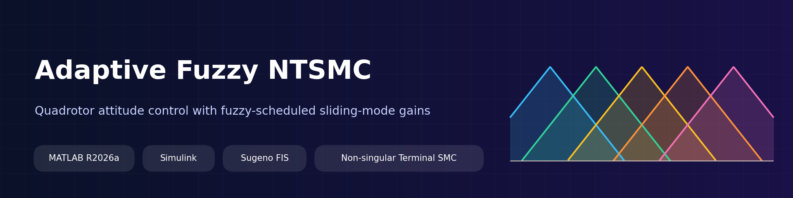
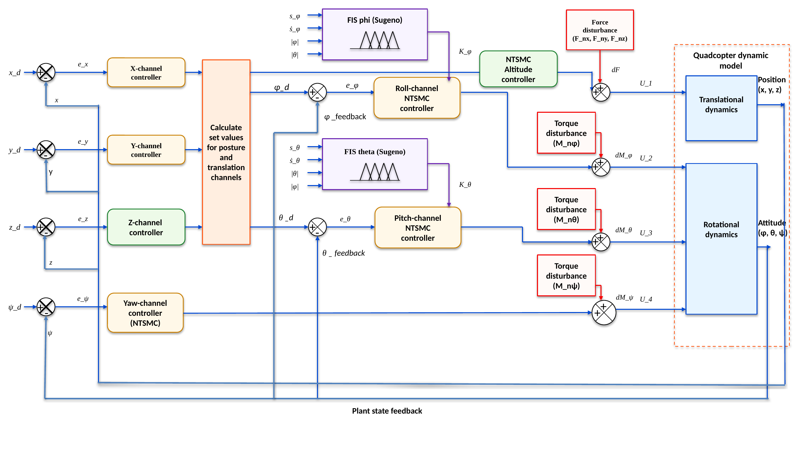
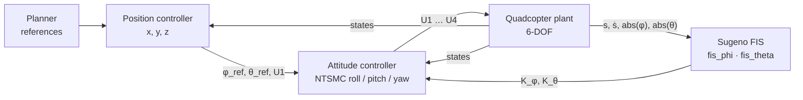
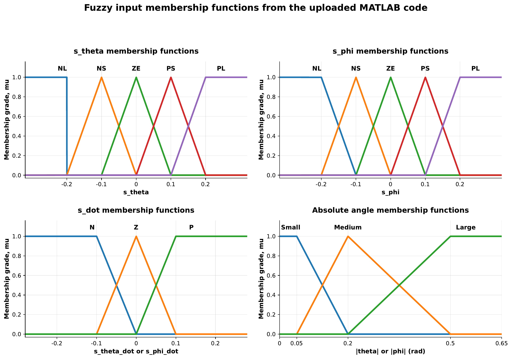
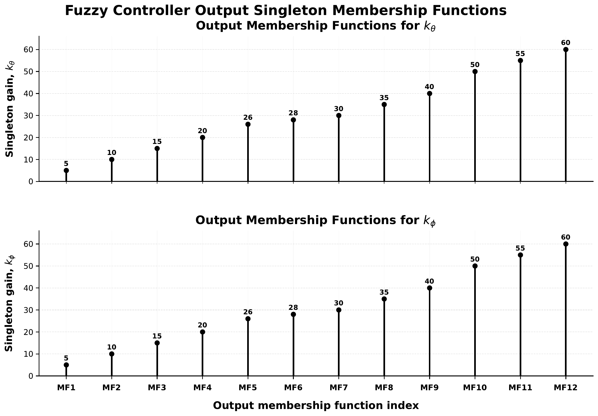
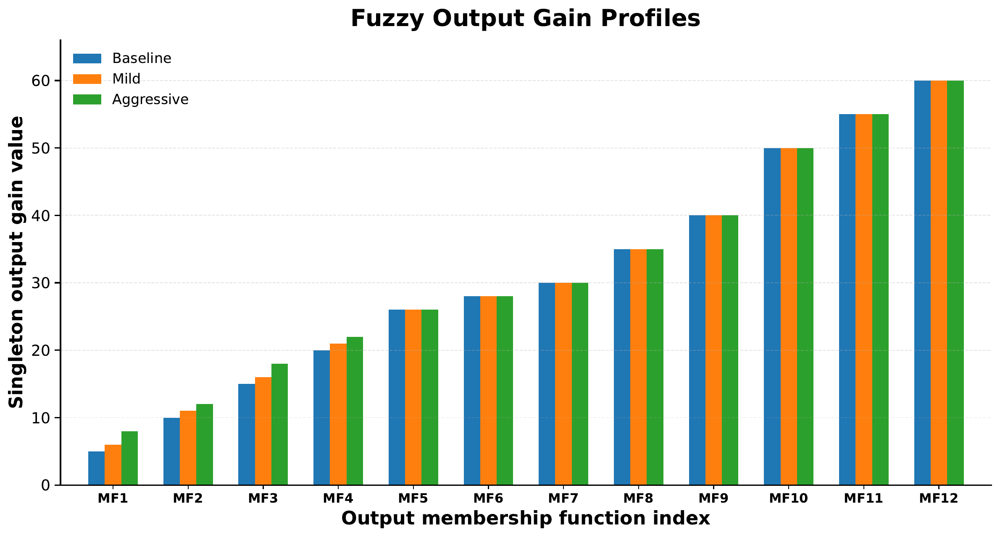
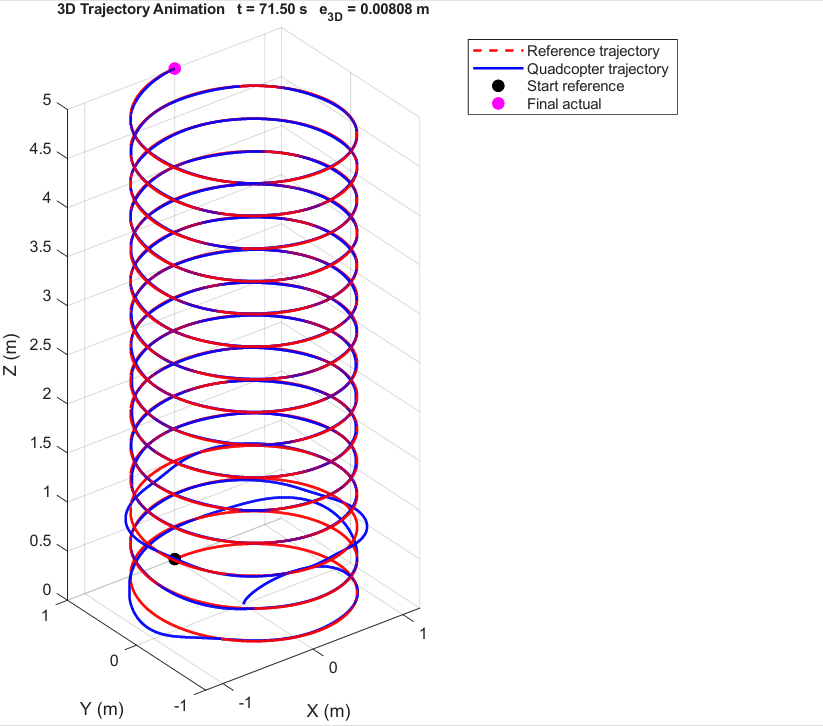
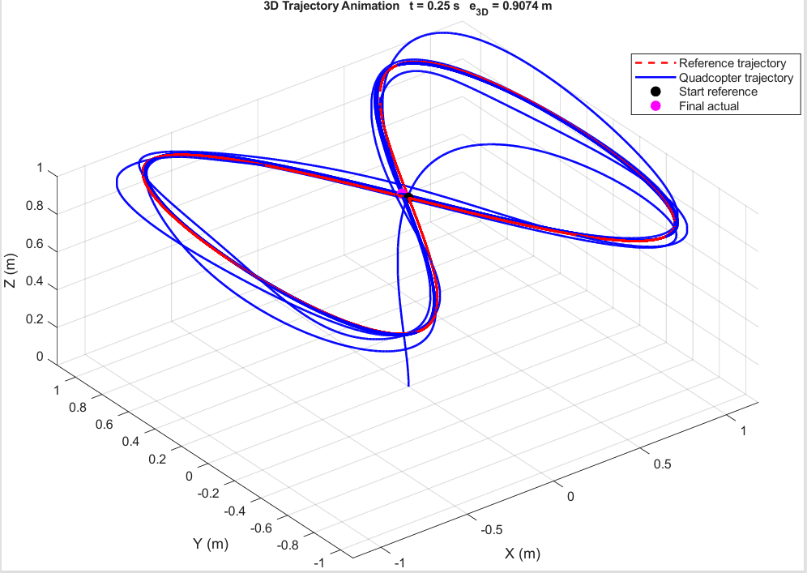

<div align="center">



# Adaptive Fuzzy Non-singular Terminal Sliding Mode Control for a Quadrotor

**A MATLAB/Simulink implementation where two Sugeno fuzzy systems tune the roll and pitch sliding-mode gains online.**


[Overview](#-overview) · [Architecture](#-control-architecture) · [Fuzzy design](#-fuzzy-gain-scheduler) · [Quick start](#-quick-start) · [Results](#-results) · [Repository layout](#-repository-layout)

</div>

---

## ✨ Overview

This repository contains a Simulink model of a quadrotor controlled by a **non-singular terminal sliding mode controller (NTSMC)** whose roll and pitch gains are **adapted online by fuzzy inference**.

- **NTSMC** for the attitude channels gives finite-time convergence without the singularity of conventional terminal sliding mode.
- **Two Sugeno FIS blocks** (`fis_phi`, `fis_theta`) output the sliding-mode gains `K_φ` and `K_θ` in real time instead of using fixed values.
- A **cascaded structure**: position loop → desired roll/pitch → attitude NTSMC → control inputs `U1…U4` → 6-DOF quadrotor plant.
- This version is the **disturbance-free** case (`No_Dsturb`). The architecture diagram also shows where force/torque disturbances enter.

## 🧭 Control architecture

<p align="center">
  
</p>

The same structure as it appears in the Simulink model:



| Block (in the model) | Role |
|---|---|
| **Planner** | Provides the reference signals |
| **Controller → Position Controller** | Computes desired roll/pitch (`φ_ref`, `θ_ref`) and total thrust `U1` |
| **Controller → Attitude Controller** | NTSMC for roll, pitch and yaw → `U2`, `U3`, `U4` |
| **FIS phi / FIS theta** | Fuzzy Logic Controller blocks that produce `K_φ` and `K_θ` |
| **Quadcopter plant** | 6-DOF rigid-body model driven by `U1…U4`, returns the state bus |

## 🧠 Fuzzy gain scheduler

Each channel uses a **4-input Sugeno** system that outputs one gain:

| Input | Meaning | Membership functions | Range |
|---|---|---|---|
| `s_φ` / `s_θ` | sliding variable | NL, NS, ZE, PS, PL | −0.2 … 0.2 |
| `ṡ_φ` / `ṡ_θ` | sliding variable rate | N, Z, P | −0.2 … 0.2 |
| `abs(φ)`, `abs(θ)` | absolute angle magnitudes | Small, Medium, Large | 0 … 0.65 rad |

**Output:** 12 singleton gains per channel (`MF1 … MF12`):
`5, 10, 15, 20, 26, 28, 30, 35, 40, 50, 55, 60`

<p align="center">
  
</p>

<p align="center">
  
</p>

### Output gain profiles

Three singleton profiles (**Baseline**, **Mild**, **Aggressive**) were compared. They differ only in the low-gain singletons (`MF1 … MF4`), where Aggressive is highest and Baseline lowest; from `MF5` upward all three are identical.

<p align="center">
  
</p>

## 🚀 Quick start

### Requirements

- MATLAB **R2026a** (the model was saved with this release)
- Simulink
- Fuzzy Logic Toolbox
- Aerospace Blockset (6-DOF and Flat-Earth-to-LLA blocks used in the plant)

### Run

```matlab
% 1. clone the repo and open MATLAB in its root folder
cd Adaptive-Fuzzy-Sliding-Mode-Controller

% 2. run the simulation (loads parameters + FIS files, then simulates)
run('scripts/run_simulation.m')
```

Or open the model directly:

```matlab
open_system('model/Adaptive_fuzzy_NTSMC_No_Dsturb.slx')
```

> **Note:** the model reads its parameters (`mass`, `Ix`, `gama`, `ro`, `beta_*`, `kp_*`, `kd_*`, …) and the two FIS objects (`fis_phi`, `fis_theta`) from the MATLAB base workspace. `run_simulation.m` loads them from `model/params.mat` and `fis/*.fis`.

### Simulation settings (stored in the model)

| Setting | Value |
|---|---|
| Solver | Fixed-step |
| Step size | 0.005 s |
| Stop time | 150 s |
| Fuzzy blocks | `fis_phi`, `fis_theta` (Fuzzy Logic Controller blocks, lookup table off) |

## 📈 Results

3D trajectory tracking in simulation. The red dashed line is the reference, the blue line is the quadcopter path.

### Helical trajectory

<p align="center">
  
</p>

After the initial transient near the start point, the quadcopter path lies on top of the reference helix. The 3D position error shown in the figure is **0.00808 m at t = 71.5 s**.

### Figure-eight trajectory

<p align="center">
  
</p>

The quadcopter converges onto the figure-eight reference from its starting position.

## 🔧 Workspace variables used by the model

| Group | Variables |
|---|---|
| Plant | `mass`, `g`, `Ix`, `Iy`, `Iz`, `U2Omega`, `X0` |
| Rotational dynamics coefficients | `a1 … a5` |
| NTSMC parameters | `gama`, `ro`, `beta_phi`, `beta_theta`, `beta_psi` |
| Yaw controller | `k_psi1`, `k_psi2` |
| Position loop | `kp_x`, `kp_y`, `kp_z`, `kd_x`, `kd_y`, `kd_z` |
| Run setup | `Tfinal`, `slctr` |
| Fuzzy systems | `fis_phi`, `fis_theta` |

## 📁 Repository layout

```
Adaptive-Fuzzy-Sliding-Mode-Controller/
├── model/
│   └── Adaptive_fuzzy_NTSMC_No_Dsturb.slx   # Simulink model
├── fis/                                      # fis_phi.fis, fis_theta.fis
├── scripts/
│   ├── export_model_assets.m                 # save FIS + parameters from your workspace
│   └── run_simulation.m                      # load everything and simulate
├── docs/
│   ├── control_architecture.pptx             # editable architecture diagram
│   ├── fuzzy/                                # vector PDFs of all membership-function figures
│   └── images/                               # PNGs used in this README
├── CITATION.cff
├── LICENSE
└── README.md
```

## 📚 Citation

If this model helps your work, please cite it (GitHub's **Cite this repository** button uses `CITATION.cff`).

## 📄 License

Released under the [MIT License](LICENSE).
